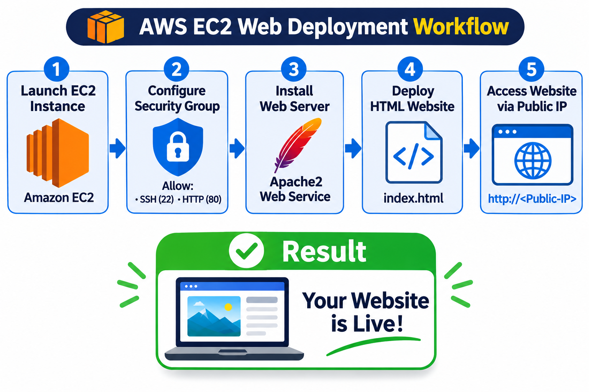

# AWS EC2 Static Website Deployment

## Project Overview
This project demonstrates how to deploy a static HTML website on an AWS EC2 instance using the Apache web server.

## AWS Services Used
- Amazon EC2
- Security Groups

## Technologies
- Ubuntu Linux
- Apache Web Server
- HTML
- Git & GitHub

## Deployment Steps
1. Launch an Ubuntu EC2 instance.
2. Configure Security Group to allow SSH (22) and HTTP (80).
3. Connect to EC2 using SSH.
4. Install Apache Web Server.
5. Deploy the HTML file.
6. Access the website using the EC2 Public IP.

## Project Result
The static website is publicly accessible through the EC2 public IP address.

